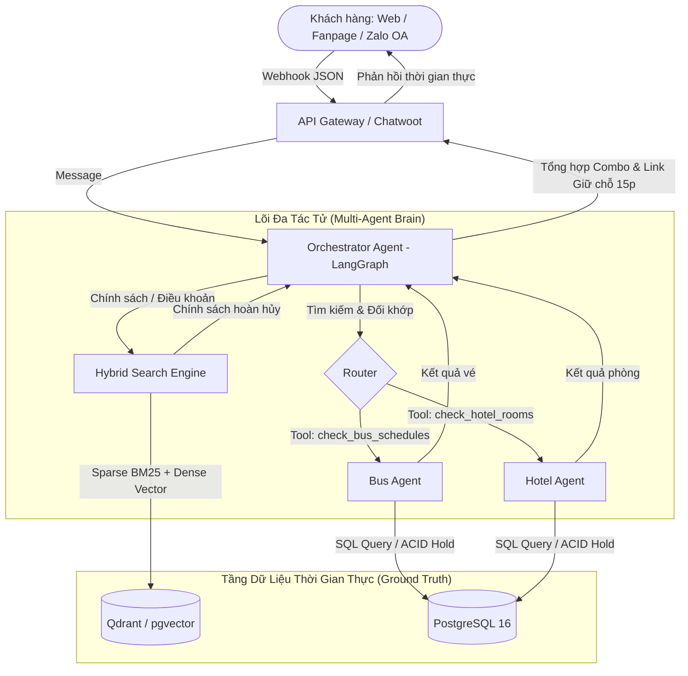

# 🏨 AI Travel Booking Orchestrator

[](https://fastapi.tiangolo.com)
[](https://langchain-ai.github.io/langgraph/)
[](https://qdrant.tech/)
[](https://www.postgresql.org/)
[](https://opensource.org/licenses/MIT)

> **Tác tử Trí tuệ Nhân tạo Đa nhiệm (Autonomous Multi-Agent AI Orchestrator)** giải quyết triệt để 3 bài toán nan giải trong nghiệp vụ tư vấn & đặt chỗ du lịch (Xe khách & Lưu trú):
> 1. **Ảo giác dữ liệu động (Dynamic Hallucination):** Tự động liên kết SQL/PMS bằng **Function Calling** theo thời gian thực (Zero False Inventory).
> 2. **Sai lệch từ khóa (Keyword Mismatch):** Truy xuất chính xác mã phòng, loại xe qua thuật toán lai **Hybrid Search (BM25 + Dense pgvector/Qdrant)** gộp điểm bằng **Reciprocal Rank Fusion (RRF)**.
> 3. **Ràng buộc chéo (Cross-domain Constraints):** Tự động đối khớp thời gian giữa chuyến xe và giờ Check-in/Check-out khách sạn bằng kiến trúc **Multi-Agent StateGraph (LangGraph)**.

---

## 🏛️ 1. Kiến trúc Tổng thể (High-Level Architecture)



---

## 🔬 2. Ba Công Nghệ Nhỏ Tạo Nên Sự Khác Biệt (Key Technical Innovations)

| Bài toán khó | Công nghệ lõi giải quyết | Cơ chế hoạt động |
| :--- | :--- | :--- |
| **Ảo giác dữ liệu tồn kho** | **Function Calling / Tool Use** | Cưỡng chế LLM trả về cấu trúc tham số Pydantic; chọc thẳng vào DB thời gian thực với khóa bi quan (`SELECT ... FOR UPDATE`). |
| **Sai lệch tên phòng / nhà xe** | **Hybrid Search + RRF** | Kết hợp **BM25** (bắt chính xác mã phòng, tên nhà xe) và **Dense Vector** (hiểu ngữ nghĩa câu hỏi), tái xếp hạng qua công thức RRF: $RRF(d) = \sum \frac{1}{k + r_i(d)}$. |
| **Lệch giờ xe và giờ nhận phòng** | **Multi-Agent StateGraph** | Tác tử Orchestrator sử dụng kỹ thuật Chain-of-Thought (CoT) đối chiếu thời gian đến của xe giường nằm với giờ nhận phòng khách sạn (14:00) để cảnh báo hoặc đề xuất nhận phòng sớm. |

---

## 🚀 3. Hướng Dẫn Cài Đặt Nhanh (Quickstart - 3 Phút)

### Yêu cầu môi trường
- Python >= 3.11
- Docker & Docker Compose

### 1. Khởi chạy CSDL & Dịch vụ hỗ trợ
```bash
docker compose up -d postgres-db qdrant
```

### 2. Cài đặt Dependencies cho Lõi AI
```bash
cd 02-core-microservices/backend
python -m venv venv
# Windows:
.\venv\Scripts\activate
# Linux/Mac:
source venv/bin/activate

pip install -r requirements.txt
```

### 3. Khởi chạy Lõi AI API
```bash
uvicorn app.main:app --host 0.0.0.0 --port 8000 --reload
```
Truy cập tài liệu Swagger UI trực quan tại: `http://localhost:8000/docs`

---

## 📚 4. Thư Mục Tài Liệu Báo Cáo Đồ Án (Thesis Documentation)

Toàn bộ báo cáo và thuyết minh kỹ thuật chi tiết phục vụ Đồ án Khoa học Máy tính / Công nghệ Phần mềm được lưu trữ tại:
- 📖 [Đặc tả Kiến trúc & Thuật toán (Full Specs)](docs/01_architecture_and_algorithms.md)
- 📊 [Bộ Tiêu chuẩn Đánh giá & Kịch bản Kiểm thử](docs/02_evaluation_metrics.md)
- 🔌 [Tài liệu Tích hợp Plug-and-Play API Contracts](docs/03_api_contracts_and_plugins.md)
- 🎓 [Source LaTeX Báo cáo Tốt nghiệp chuẩn ĐH Bách Khoa HCM](03-ai-orchestrator-report/report/thesis_report.tex)

---

## 👥 Đóng Góp & Hợp Tác (Contribution)
Dự án được thiết kế theo mô hình Microservices Plug-and-Play. Các module Agent, Tool và Search Engine hoàn toàn độc lập, có thể tách rời và tích hợp vào các hệ thống ERP, CRM, PMS du lịch khác. Mọi đóng góp (Pull Request, Issue) đều được hoan nghênh!

- **Tác giả:** Phan Thành Long ([@Longphanxdragon](https://github.com/Longphanxdragon))
- **Kho lưu trữ:** [https://github.com/Longphanxdragon/ai-travel-booking-orchestrator-](https://github.com/Longphanxdragon/ai-travel-booking-orchestrator-)
