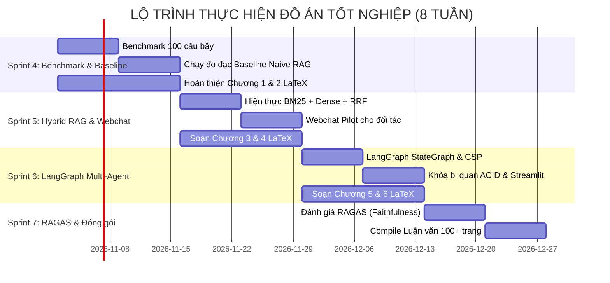

# 🚀 MASTER ROADMAP: AI TRAVEL & HOSPITALITY ORCHESTRATOR
*(Bản tương thích 100% định dạng Markdown / Notion Database / GitHub Trackers)*

---

## 📌 THÔNG TIN DỰ ÁN (PROJECT OVERVIEW)

- **Tên Đề tài Học thuật:** *Ứng dụng Hybrid Search, Function Calling và Multi-Agent nhằm giải quyết bài toán ảo giác, sai lệch từ khóa và ràng buộc chéo trong tư vấn đặt xe khách và khách sạn.*
- **Giảng viên Hướng dẫn:** Thầy Hùng (Khoa Khoa học \& Kỹ thuật Máy tính -- HCMUT)
- **Sinh viên thực hiện:** Phan Thành Long ([@Longphanxdragon](https://github.com/Longphanxdragon))
- **Mục tiêu kép:** 
  1. Bảo vệ Luận văn Tốt nghiệp điểm 10 (CS Track -- Khoa học Máy tính).
  2. Đóng gói SaaS Pilot tạo Bánh đà Dữ liệu độc quyền ([Data Flywheel](docs/06_proprietary_data_flywheel_strategy.md)).
- **Thời gian bắt đầu:** 21/09/2026 | **Ngày hiện tại:** 29/10/2026 (Tuần 6 -- Mốc Chốt sổ ĐACN)
- **Kho lưu trữ chính thức:** [GitHub Repository](https://github.com/Longphanxdragon/ai-travel-booking-orchestrator-)
- **Tài liệu tham chiếu chuẩn:** [PROJECT_STATE_SNAPSHOT.md](PROJECT_STATE_SNAPSHOT.md)

---

## 📊 DASHBOARD THEO DÕI TIẾN ĐỘ TỔNG THỂ (NOTION COMPATIBLE)

| Sprint | Thời gian | Trọng tâm Kỹ thuật | Trọng tâm Doanh nghiệp (Pilot) | Tiến độ Báo cáo LaTeX | Trạng thái | Liên kết Minh chứng |
| :--- | :--- | :--- | :--- | :--- | :---: | :--- |
| **ĐACN Sprint 1** | 21/09 – 04/10 | Khảo sát bài toán, Literature review, chọn Baseline | Khảo sát nhu cầu nhà xe / homestay | Đề cương chi tiết | **Done** | [thesis_report.tex](03-ai-orchestrator-report/report/thesis_report.tex) |
| **ĐACN Sprint 2** | 05/10 – 18/10 | Thiết kế Microservices, Schema PostgreSQL, CI/CD | Chuẩn hóa API Contract | Kiến trúc hệ thống | **Done** | [database-init.sql](03-shared-contracts/database-init.sql) • [ci.yml](.github/workflows/ci.yml) |
| **ĐACN Sprint 3** | 19/10 – 28/10 | Prototype Tool Calling VeXeRe & Pipeline PII | Kiểm thử kết nối dữ liệu sống | Khung báo cáo LaTeX BKU | **Done** | [vexere_adapter.py](02-core-microservices/backend/app/services/tools/vexere_realtime_adapter.py) • [BaoCao_BKU](03-ai-orchestrator-report/report/BaoCao_BKU/) |
| 🔴 **MỐC TODAY** | **29/10/2026** | **Nghiệm thu Prototype ĐACN với Thầy Hùng & Bảo vệ Kế hoạch ĐATN** | — | — | **Current** | [Master Plan](docs/05_30_days_thesis_and_gtm_master_plan.md) |
| **ĐATN Sprint 1** | 02/11 – 15/11 | Xây dựng Benchmark 100 câu bẫy & Đo đạc Baseline | Khảo sát đối tác triển khai Pilot | Chương 1 & Chương 2 (Đã draft) | **In Progress** | [01_GioiThieu](03-ai-orchestrator-report/report/BaoCao_BKU/Contents/01_GioiThieu/) • [02_CoSoLyThuyet](03-ai-orchestrator-report/report/BaoCao_BKU/Contents/02_CoSoLyThuyet/) |
| **ĐATN Sprint 2** | 16/11 – 29/11 | Hiện thực Hybrid Search (BM25 + Cosine + RRF) | Đóng gói Webchat cắm vào đối tác | Chương 3 & Chương 4 | **To Do** | [01_architecture_and_algorithms.md](docs/01_architecture_and_algorithms.md) |
| **ĐATN Sprint 3** | 30/11 – 13/12 | Multi-Agent LangGraph giải bài toán ràng buộc (CSP) | Vận hành Pilot, thu thập log thực tế | Chương 5 & Chương 6 | **To Do** | [orchestrator.py](02-core-microservices/backend/app/services/agent/orchestrator.py) |
| **ĐATN Sprint 4** | 14/12 – 27/12 | Đánh giá RAGAS (Faithfulness) & Nghiệm thu | Báo cáo phân tích thị trường Pilot | Hoàn thiện Báo cáo 100+ trang | **To Do** | [02_evaluation_metrics.md](docs/02_evaluation_metrics.md) |

---

## GIAI ĐOẠN 1: ĐỒ ÁN CHUYÊN NGÀNH (ĐACN) — [100% HOÀN THÀNH]

### 🔴 MỐC CHỐT SỔ ĐACN (HÔM NAY - 29/10/2026)
- [x] **Hạ tầng CSDL Quan hệ ACID:** Hoàn thiện [03-shared-contracts/database-init.sql](03-shared-contracts/database-init.sql) với đầy đủ bảng `hotel_rooms`, `bus_trips`, `travel_intents_lake`, `reservations`.
- [x] **Live Data Adapter:** Module [vexere_realtime_adapter.py](02-core-microservices/backend/app/services/tools/vexere_realtime_adapter.py) đã kiểm thử thực tế cào dữ liệu sống từ VeXeRe (Phương Trang, Điền Linh, Phong Phú, An Anh).
- [x] **Bảo vệ Dữ liệu Cá nhân (PII):** Module [data_cleaner_pipeline.py](02-core-microservices/backend/app/services/tools/data_cleaner_pipeline.py) tự động ẩn danh hóa SĐT (`090****567`) và Email.
- [x] **Đồ thị Trạng thái & Ràng buộc chéo cơ bản:** [orchestrator.py](02-core-microservices/backend/app/services/agent/orchestrator.py) kết hợp [travel_tools.py](02-core-microservices/backend/app/services/tools/travel_tools.py) tự động tính độ lệch thời gian $\Delta T > 3h$ và đề xuất nhận phòng sớm / gửi đồ.
- [x] **Tự động hóa Kiểm thử & CI/CD:** [ci.yml](.github/workflows/ci.yml) và bộ unit test [test_core_system.py](02-core-microservices/backend/tests/test_core_system.py) đạt kết quả **3/3 Passed (100%)**.
- [x] **Khung Báo cáo LaTeX Chuẩn BKU:** Đã thiết lập [BaoCao_BKU/](03-ai-orchestrator-report/report/BaoCao_BKU/) và hoàn thành bản thảo chuyên sâu Chương 1 & Chương 2.

---

## GIAI ĐOẠN 2: ĐỒ ÁN TỐT NGHIỆP (ĐATN) — [LỘ TRÌNH 8 TUẦN CHI TIẾT]

---

### 📌 SPRINT 4 (Tuần 1–2 ĐATN: 02/11/2026 – 15/11/2026)
**Chủ đề:** Xây dựng Tập dữ liệu Benchmark Chuẩn & Hiện thực Mô hình Nền (Baseline)  
**🎯 Mục tiêu:** Tạo bộ dữ liệu kiểm nghiệm độc lập (chủ động 100% không phụ thuộc đối tác) và chạy đo lường Baseline Naive RAG để lấy số liệu đối chứng ban đầu.

#### 📋 To-do List chi tiết:
- [ ] **Track 1: Thuật toán & Kỹ thuật (Chủ động)**
  - [ ] Tạo file `benchmark_dataset.json` gồm 100 câu hỏi bẫy chuẩn hóa:
    - 35 câu bẫy Dữ liệu động (hỏi phòng/vé đã hết, giá biến động theo ngày).
    - 35 câu bẫy Sai lệch từ khóa (mã phòng trùng nhau: *Deluxe King* vs *Deluxe Twin*; xe *Cabin đơn* vs *Cabin đôi*).
    - 30 câu bẫy Ràng buộc chéo (xe đến lúc 04:30 sáng, khách đòi nhận phòng ngay).
  - [ ] Viết module `baseline_rag.py`: Chỉ dùng Dense Vector Embeddings + Prompting tĩnh, không có Tool.
  - [ ] Chạy 100 câu benchmark qua `baseline_rag.py`, ghi nhận toàn bộ log lỗi ảo giác và sai sót ra file `baseline_results.json`.
- [ ] **Track 2: Báo cáo LaTeX**
  - [x] Soạn thảo [Chương 1: Tổng quan Đề tài](03-ai-orchestrator-report/report/BaoCao_BKU/Contents/01_GioiThieu/) (Bối cảnh du lịch trực tuyến, 3 thách thức kỹ thuật lớn) (~12 trang).
  - [x] Soạn thảo [Chương 2: Cơ sở Lý thuyết](03-ai-orchestrator-report/report/BaoCao_BKU/Contents/02_CoSoLyThuyet/) (Phần 1: Giới hạn Naive RAG, Toán học BM25 & RRF, Function Calling ACID, LangGraph CoT) (~25 trang).
- [ ] **Track 3: Pilot Doanh nghiệp (Song song)**
  - [ ] Liên hệ và chốt danh sách 1–2 Homestay / Nhà xe đối tác để chuẩn bị thử nghiệm giao diện.
  - [ ] Thu thập các văn bản quy định thực tế của đối tác (chính sách phụ thu trẻ em, quy định hủy phòng mùa cao điểm) để làm ngữ liệu RAG.

**📦 Deliverables cuối Sprint 4:**
- [ ] File `tests/benchmark_dataset.json` (100 câu hỏi kèm Ground Truth).
- [ ] Module `baseline_rag.py` và bảng số liệu lỗi của Naive RAG.
- [x] Bản thảo Chương 1 và Chương 2 hoàn chỉnh bằng LaTeX tại [BaoCao_BKU](03-ai-orchestrator-report/report/BaoCao_BKU/).

---

### 📌 SPRINT 5 (Tuần 3–4 ĐATN: 16/11/2026 – 29/11/2026)
**Chủ đề:** Hiện thực Lõi Hybrid Search RAG & Triệt tiêu Sai lệch Từ khóa  
**🎯 Mục tiêu:** Kết hợp tìm kiếm thưa (BM25) và tìm kiếm dày (Cosine Vector) bằng giải thuật Reciprocal Rank Fusion (RRF); đóng gói cổng thử nghiệm Webchat cho đối tác.

#### 📋 To-do List chi tiết:
- [ ] **Track 1: Thuật toán & Kỹ thuật (Chủ động)**
  - [ ] Xây dựng module `bm25_search.py` sử dụng thư viện Rank-BM25 để bắt chính xác từ khóa mã phòng, tên nhà xe.
  - [ ] Xây dựng module `dense_search.py` nhúng các đoạn văn bản chính sách vào Qdrant/pgvector.
  - [ ] Hiện thực giải thuật gộp hạng **Reciprocal Rank Fusion (RRF)**:
    $$RRF(d) = \sum_{m \in M} \frac{1}{k + r_m(d)} \quad (với\ k = 60)$$
  - [ ] Kiểm thử giải thuật trên 35 câu hỏi bẫy từ khóa: Chứng minh tỷ lệ tìm đúng mã phòng tăng từ $55\%$ (ở Baseline) lên $\ge 95\%$.
- [ ] **Track 2: Báo cáo LaTeX**
  - [ ] Soạn thảo [Chương 3: Phân tích Yêu cầu Hệ thống](03-ai-orchestrator-report/report/BaoCao_BKU/Contents/03_YeuCauHeThong/) (Yêu cầu chức năng, phi chức năng, độ trễ $< 1.5$s) (~12 trang).
  - [ ] Soạn thảo [Chương 4: Đặc tả Ca sử dụng](03-ai-orchestrator-report/report/BaoCao_BKU/Contents/04_DacTaUseCase/) (Use Case Specs & Activity Diagrams) (~12 trang).
- [ ] **Track 3: Pilot Doanh nghiệp (Song song)**
  - [ ] Đóng gói Webchat Widget / Zalo Webhook kết nối trực tiếp với backend FastAPI qua [main.py](02-core-microservices/backend/app/main.py).
  - [ ] Cài đặt thử nghiệm cho kênh chat của đối tác, kích hoạt [data_cleaner_pipeline.py](02-core-microservices/backend/app/services/tools/data_cleaner_pipeline.py) để thu thập log hội thoại thực tế của người dùng.

**📦 Deliverables cuối Sprint 5:**
- [ ] Module `hybrid_search_engine.py` hoàn chỉnh và vượt qua các unit tests.
- [ ] Bảng so sánh độ chính xác truy xuất (MRR, Recall@K) giữa Dense vs BM25 vs Hybrid RRF.
- [ ] Giao diện Webchat thử nghiệm hoạt động thực tế tại đối tác.
- [ ] Bản thảo hoàn chỉnh Chương 3 và Chương 4 bằng LaTeX.

---

### 📌 SPRINT 6 (Tuần 5–6 ĐATN: 30/11/2026 – 13/12/2026)
**Chủ đề:** Hoàn thiện Multi-Agent LangGraph & Giải quyết Ràng buộc chéo (CSP)  
**🎯 Mục tiêu:** Xây dựng đồ thị trạng thái LangGraph StateGraph điều phối 3 tác tử: Bus Agent, Hotel Agent và Matching Orchestrator để tự động giải bài toán lệch giờ giấc.

#### 📋 To-do List chi tiết:
- [ ] **Track 1: Thuật toán & Kỹ thuật (Chủ động)**
  - [ ] Thiết lập LangGraph StateGraph với các nốt (Nodes) và cạnh có điều kiện (Conditional Edges):
    - `RouterNode`: Bóc tách ý định người dùng (Intent Classification).
    - `BusNode`: Gọi [VexereRealtimeAdapter](02-core-microservices/backend/app/services/tools/vexere_realtime_adapter.py) lấy giờ xe chạy và số ghế.
    - `HotelNode`: Gọi PostgreSQL CSDL lấy phòng trống.
    - `ConstraintSatisfactionNode`: Giải bài toán thỏa mãn ràng buộc (CSP): Nếu giờ xe đến cách giờ check-in $> 4$ tiếng $\rightarrow$ Tự động kích hoạt gói gợi ý nhận phòng sớm / gửi hành lý.
  - [ ] Tích hợp cơ chế khóa bi quan (`SELECT ... FOR UPDATE`) theo đặc tả tại [01_architecture_and_algorithms.md](docs/01_architecture_and_algorithms.md).
  - [ ] Xây dựng giao diện Demo tương tác trực quan bằng Streamlit/Gradio để phục vụ việc bảo vệ trước Hội đồng.
- [ ] **Track 2: Báo cáo LaTeX**
  - [ ] Soạn thảo [Chương 5: Thiết kế Kiến trúc Hệ thống](03-ai-orchestrator-report/report/BaoCao_BKU/Contents/05_PhanTichThietKe/) (Sơ đồ StateGraph, sơ đồ tuần tự Sequence Diagram, lược đồ CSDL) (~25 trang).
  - [ ] Soạn thảo [Chương 6: Hiện thực Hệ thống](03-ai-orchestrator-report/report/BaoCao_BKU/Contents/06_HienThuc/) (Chi tiết triển khai mã nguồn cốt lõi) (~20 trang).
- [ ] **Track 3: Pilot Doanh nghiệp (Song song)**
  - [ ] Trích xuất các mẫu hình câu hỏi khó của khách từ log thực tế bổ sung vào tập kiểm thử mở rộng.
  - [ ] Đo lường độ trễ trung bình khi phục vụ khách hàng thực qua kênh chat (mục tiêu: $< 1.8$ giây).

**📦 Deliverables cuối Sprint 6:**
- [ ] Toàn bộ mã nguồn Multi-Agent Orchestrator hoạt động End-to-End trên LangGraph.
- [ ] Ứng dụng Web Demo Streamlit sẵn sàng trình chiếu.
- [ ] Bản thảo hoàn chỉnh Chương 5 và Chương 6 bằng LaTeX.

---

### 📌 SPRINT 7 (Tuần 7–8 ĐATN: 14/12/2026 – 27/12/2026)
**Chủ đề:** Thực nghiệm Khoa học Toàn diện RAGAS, Đóng gói Luận văn 100+ trang & Nghiệm thu  
**🎯 Mục tiêu:** Đo lường khoa học bằng framework RAGAS, xuất bản file PDF Luận văn tốt nghiệp 100+ trang và chuẩn bị slide bảo vệ điểm 10.

#### 📋 To-do List chi tiết:
- [ ] **Track 1: Thuật toán & Thực nghiệm Đánh giá (Khoa học Máy tính)**
  - [ ] Chạy tự động tập 100 câu hỏi bẫy Benchmark qua cả 2 hệ thống: Naive RAG vs Hệ thống đề xuất.
  - [ ] Đo lường định lượng các chỉ số khoa học theo tiêu chuẩn quốc tế (tham chiếu [02_evaluation_metrics.md](docs/02_evaluation_metrics.md)):
    - **Faithfulness (Độ trung thực - Đo tỷ lệ ảo giác):** Mục tiêu Naive RAG $\approx 55\% \rightarrow$ Hệ thống đề xuất $\ge 98\%$.
    - **Answer Relevance (Độ liên quan):** Mục tiêu $\ge 92\%$.
    - **Context Precision / Recall:** Mục tiêu $\ge 90\%$.
    - **Task Success Rate (TSR):** Tỷ lệ ghép thành công combo xe - phòng thỏa mãn ràng buộc giờ giấc (mục tiêu $\ge 95\%$).
  - [ ] Xuất bảng số liệu và vẽ biểu đồ so sánh đối chứng khoa học đưa vào Luận văn.
- [ ] **Track 2: Hoàn thiện Báo cáo LaTeX & Đóng gói Luận văn**
  - [ ] Soạn thảo [Chương 7: Thực nghiệm và Đánh giá](03-ai-orchestrator-report/report/BaoCao_BKU/Contents/07_KiemThu/) (Phân tích chi tiết các bảng đo lường RAGAS và so sánh đối chứng) (~15 trang).
  - [ ] Soạn thảo [Chương 8: Thảo luận, Triển khai & Bánh đà Dữ liệu Thực tế](03-ai-orchestrator-report/report/BaoCao_BKU/Contents/08_TrienKhai/) (~10 trang).
  - [ ] Soạn thảo [Chương 9: Tổng kết và Hướng phát triển](03-ai-orchestrator-report/report/BaoCao_BKU/Contents/09_TongKet/) (~5 trang).
  - [ ] Biên dịch toàn bộ tài liệu bằng LaTeX Engine xuất file `thesis_report.pdf` (Tổng độ dài: 110 -- 130 trang chuẩn Bách Khoa).
- [ ] **Track 3: Nghiệm thu Doanh nghiệp & Slide Bảo vệ**
  - [ ] Xuất báo cáo phân tích nhu cầu khách hàng từ Bánh đà Dữ liệu gửi thư cảm ơn đối tác thử nghiệm.
  - [ ] Thiết kế bộ Slide bảo vệ Luận văn (25 slides ngắn gọn, súc tích, làm nổi bật kết quả thực nghiệm RAGAS và demo trực tiếp).

**📦 Deliverables cuối Sprint 7 (Chốt sổ Luận văn Tốt nghiệp):**
- [ ] File Luận văn tốt nghiệp hoàn chỉnh `thesis_report.pdf` (100+ trang).
- [ ] Kho mã nguồn GitHub sạch đẹp, đầy đủ tài liệu hướng dẫn cài đặt [README.md](README.md).
- [ ] Video clip Demo 2 phút + Bộ Slide bảo vệ trước Hội đồng chấm thi.

---

## 🛠️ PHÂN CHIA TRÁCH NHIỆM & CÔNG CỤ (RACI MATRIX)

| Vai trò | Người phụ trách | Công cụ sử dụng | Trách nhiệm chính |
| :--- | :--- | :--- | :--- |
| **Product Owner & Researcher** | **BẠN** | GitHub, Notion, Overleaf | Giao nhiệm vụ theo từng Sprint, kiểm tra file PDF xuất ra sau mỗi tuần. Gặp Thầy Hùng lấy phản hồi; đem bản demo tiếp cận 1–2 đối tác lưu trú. |
| **Lead AI Architect & Writer** | **TÔI (Antigravity)** | LaTeX, Markdown, Git | Trực tiếp soạn thảo các chương báo cáo LaTeX (toán học, công thức RRF, phân tích thuật toán). Thiết kế kiến trúc trong [docs/](docs/). Tự động đồng bộ và bảo vệ code qua GitHub Actions. |
| **Code Implementation Engine** | **CURSOR / CLAUDE** | Python, LangGraph, FastAPI | Thực thi code chi tiết các module backend dựa trên các prompt chỉ định file đặc tả. |

### 💡 HƯỚNG DẪN DÙNG CURSOR / CLAUDE TRONG 8 TUẦN TỚI:
Mở Cursor và tag các file tài liệu theo cú pháp chuẩn:
> `@docs/01_architecture_and_algorithms.md @03-shared-contracts/database-init.sql Hãy code module hybrid_search_engine.py`

Cursor sẽ đọc chính xác khuôn dữ liệu và kiến trúc đã thống nhất để code mà không bao giờ bị lệch hướng!
